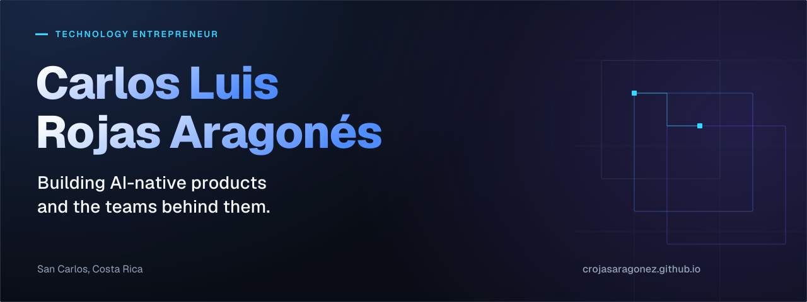

[Website](https://crojasaragonez.github.io/) · [Writing](https://crojasaragonez.github.io/blog/) · [Speaking](https://crojasaragonez.github.io/speaking/) · [LinkedIn](https://www.linkedin.com/in/crojasaragonez)

### I build technology organizations and AI-native products that ship.

I'm Carlos, a technology entrepreneur based in **San Carlos, Costa Rica**. My work spans software engineering, AI product strategy, and building teams across the Americas.

Today I'm **Co-Founder & Chief AI Officer at [Subaxa](https://subaxa.com)**, building AI-native proptech for judicial real estate auctions. I also serve on the **Board of Directors at [Golabs](https://golabstech.com)**, the nearshore engineering company I co-founded in 2014.

At Golabs, I helped scale the organization to **100+ engineers across LATAM** and built an AI division that grew to **roughly 30% of company revenue**.

### From strategy to production

| Focus | What I work with |
| :--- | :--- |
| **AI & agents** | LLM agents, multi-agent systems, RAG, vector databases, prompt & context engineering |
| **Cloud & platforms** | AWS, serverless, Docker, Terraform, event-driven architecture |
| **Software** | Python, TypeScript / JavaScript, Node.js, Ruby, PHP / Laravel |
| **Engineering leadership** | Technical strategy, organizational design, talent development, nearshore delivery |

### Selected work

| Project | What you'll find |
| :--- | :--- |
| [Light Service for PHP](https://github.com/crojasaragonez/light-service) | A PHP port of the Ruby LightService library. |
| [Presentations](https://github.com/crojasaragonez/presentations) | Technical talks and teaching materials on software engineering, cloud systems, and AI. |
| [Vue Rubik's Cube](https://github.com/crojasaragonez/vue-rubik-cube) | A Rubik's Cube built with Vue. |

### Open source contributions

| Project | Description | Year contributed |
| :--- | :--- | :--- |
| [RuboCop](https://github.com/rubocop/rubocop/pull/7317) | A Ruby static code analyzer and formatter based on the community Ruby style guide. | 2019 |
| [Lighthouse](https://github.com/nuwave/lighthouse/pull/2138) | A framework for building GraphQL APIs with Laravel. | 2022 |
| [YaST](https://github.com/yast/yast-services-manager/pull/109) | A YaST library for configuring systemd services and targets. | 2015 |
| [Laravel AI SDK](https://github.com/laravel/ai/pull/1231) | A unified Laravel API for working with AI providers including OpenAI, Anthropic, and Gemini. | 2026 |
| [RSpec Pacman Formatter](https://github.com/go-labs/rspec_pacman_formatter) | A Pacman-style formatter for RSpec test output. | 2015–2019 |

### Ideas I'm exploring

- [Digital Twins for Private Investment Funds](https://crojasaragonez.github.io/blog/digital-twins-for-private-investment-funds/)
- [How to Switch LLM Models Without Breaking Your Agents](https://crojasaragonez.github.io/blog/how-to-switch-llm-models-without-breaking-your-agents/)
- [The Real LLM Race Is Intelligence per Dollar](https://crojasaragonez.github.io/blog/the-real-llm-race-is-intelligence-per-dollar/)

[More writing →](https://crojasaragonez.github.io/blog/)

### Beyond the code

I taught Software Engineering at **Universidad Técnica Nacional (2014–2022)** and share talks on AI, cloud systems, and engineering leadership. My learning continues through the **MIT Chief Technology Officer Executive Program**.

For founder conversations, speaking, or building with AI, [connect with me on LinkedIn](https://www.linkedin.com/in/crojasaragonez).
